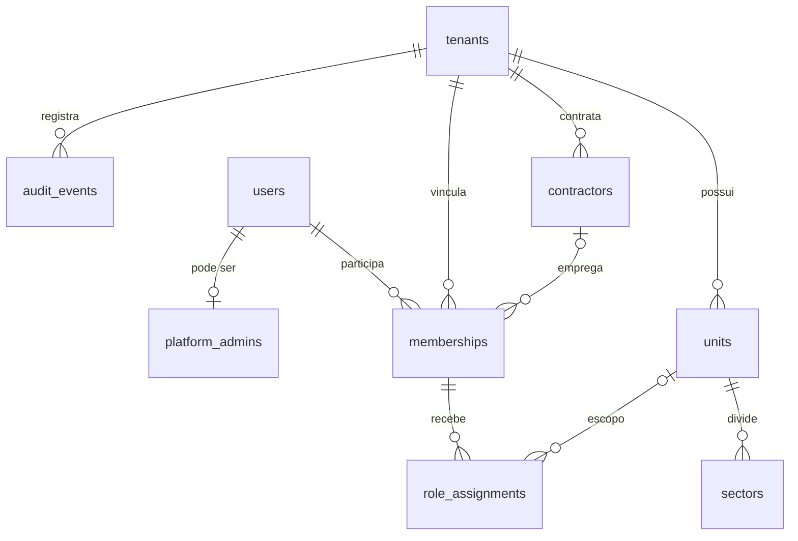

# Modelo de dados — Fase 1 (Fundação)

Versão 0.1 · 09/11/2026

Este documento cobre as tabelas da Fase 1. APR, PT, evidências, assinaturas e
retenção entram nas fases seguintes e reutilizam as mesmas regras de isolamento.

## Regras gerais

1. **Toda tabela de cliente tem `tenant_id`** e chave primária própria (`id uuid`).
2. **Chaves estrangeiras compostas** `(tenant_id, x_id) → (tenant_id, id)`: uma
   linha de uma empresa não consegue apontar para uma linha de outra, nem por erro
   de código.
3. **Row-Level Security** em todas as tabelas de cliente, com `FORCE`:
   a aplicação conecta como `sitedopai_app` (sem `BYPASSRLS`) e fixa
   `app.tenant_id` e `app.user_id` por transação. Sem esses valores, as consultas
   retornam zero linhas.
4. **Auditoria só de inserção**, com hash encadeado por empresa calculado no
   próprio banco (trigger com lock por empresa, seguro sob concorrência).
   `UPDATE` e `DELETE` são bloqueados por trigger e por permissão.
5. **Minimização (LGPD):** a Fase 1 não guarda CPF, data de nascimento nem dados
   de saúde. Esses campos só entram quando houver necessidade justificada.

## Entidades

| Tabela | Escopo | Finalidade | Campos principais |
| --- | --- | --- | --- |
| `tenants` | a própria empresa | Empresa cliente | razão social, nome fantasia, CNPJ (único), situação comercial |
| `units` | empresa | Unidade operacional / planta | nome, código (único na empresa), cidade, UF, ativo |
| `sectors` | empresa → unidade | Setor ou área dentro da unidade | nome, unidade |
| `contractors` | empresa | Prestadora de serviço | razão social, CNPJ (único na empresa) |
| `users` | global (identidade) | Pessoa que faz login (vínculo com o provedor OIDC) | `oidc_subject`, e-mail, nome |
| `memberships` | empresa | Vínculo de um usuário com uma empresa | usuário, situação (convidado, ativo, suspenso), prestadora opcional |
| `role_assignments` | empresa | Papel concedido em um escopo | vínculo, papel, escopo (`TENANT` ou `UNIT` + unidade) |
| `audit_events` | empresa | Trilha de auditoria encadeada | sequência, ator, ação, entidade, dados, `prev_hash`, `hash` |
| `platform_admins` | plataforma | Administradores comerciais | usuário; **sem** acesso a tabelas de cliente |

`users` não tem `tenant_id` porque a mesma pessoa pode atuar em mais de uma
empresa (por exemplo, um técnico de uma prestadora). A política de RLS de `users`
só mostra o próprio usuário e os usuários que têm vínculo com a empresa ativa.

## Papéis (Fase 1)

`COMPANY_ADMIN`, `SST`, `SUPERVISOR`, `EXECUTOR`, `AUDITOR`. O administrador da
plataforma não é um papel de empresa: fica em `platform_admins` e não enxerga
dados de clientes.

Qualificações (treinamentos, designações formais, aptidão) e segregação de
funções entram na Fase 3, junto com a liberação de PT.

## Diagrama

## Encadeamento da auditoria

`hash = sha256(prev_hash || tenant_id || seq || occurred_at || actor || action || entity_type || entity_id || data)`

O primeiro evento de cada empresa usa `prev_hash` igual a 64 zeros. A rota
`GET /audit-events/verify` recalcula a cadeia e aponta o primeiro elo quebrado.
Na Fase 4, o hash mais recente será ancorado periodicamente com carimbo de tempo.
