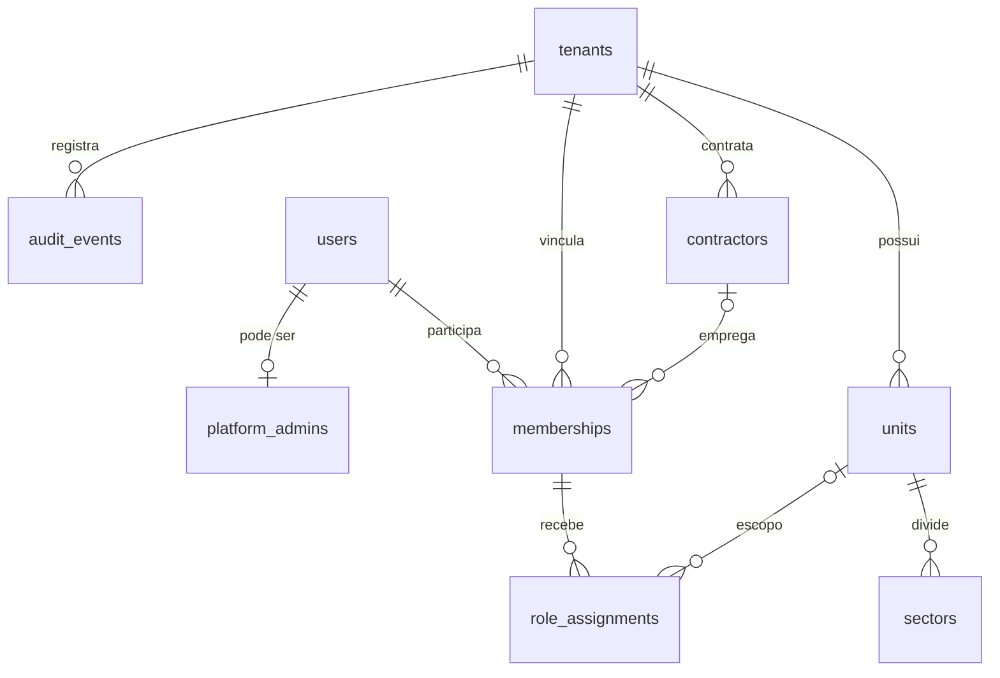

# Modelo de dados — Fase 1 (Fundação)

Versão 0.1 · 09/11/2026

Este documento cobre as tabelas da Fase 1. APR, PT, evidências, assinaturas e
retenção entram nas fases seguintes e reutilizam as mesmas regras de isolamento.

## Regras gerais

1. **Toda tabela de cliente tem `tenant_id`** e chave primária própria (`id uuid`).
2. **Chaves estrangeiras compostas** `(tenant_id, x_id) → (tenant_id, id)`: uma
   linha de uma empresa não consegue apontar para uma linha de outra, nem por erro
   de código.
3. **Row-Level Security** em todas as tabelas de cliente, com `FORCE`:
   a aplicação conecta como `sitedopai_app` (sem `BYPASSRLS`) e fixa
   `app.tenant_id` e `app.user_id` por transação. Sem esses valores, as consultas
   retornam zero linhas.
4. **Auditoria só de inserção**, com hash encadeado por empresa calculado no
   próprio banco (trigger com lock por empresa, seguro sob concorrência).
   `UPDATE` e `DELETE` são bloqueados por trigger e por permissão.
5. **Minimização (LGPD):** a Fase 1 não guarda CPF, data de nascimento nem dados
   de saúde. Esses campos só entram quando houver necessidade justificada.

## Entidades

| Tabela | Escopo | Finalidade | Campos principais |
| --- | --- | --- | --- |
| `tenants` | a própria empresa | Empresa cliente | razão social, nome fantasia, CNPJ (único), situação comercial |
| `units` | empresa | Unidade operacional / planta | nome, código (único na empresa), cidade, UF, ativo |
| `sectors` | empresa → unidade | Setor ou área dentro da unidade | nome, unidade |
| `contractors` | empresa | Prestadora de serviço | razão social, CNPJ (único na empresa) |
| `users` | global (identidade) | Pessoa que faz login (vínculo com o provedor OIDC) | `oidc_subject`, e-mail, nome |
| `memberships` | empresa | Vínculo de um usuário com uma empresa | usuário, situação (convidado, ativo, suspenso), prestadora opcional |
| `role_assignments` | empresa | Papel concedido em um escopo | vínculo, papel, escopo (`TENANT` ou `UNIT` + unidade) |
| `audit_events` | empresa | Trilha de auditoria encadeada | sequência, ator, ação, entidade, dados, `prev_hash`, `hash` |
| `platform_admins` | plataforma | Administradores comerciais | usuário; **sem** acesso a tabelas de cliente |

`users` não tem `tenant_id` porque a mesma pessoa pode atuar em mais de uma
empresa (por exemplo, um técnico de uma prestadora). A política de RLS de `users`
só mostra o próprio usuário e os usuários que têm vínculo com a empresa ativa.

## Papéis (Fase 1)

`COMPANY_ADMIN`, `SST`, `SUPERVISOR`, `EXECUTOR`, `AUDITOR`. O administrador da
plataforma não é um papel de empresa: fica em `platform_admins` e não enxerga
dados de clientes.

Qualificações (treinamentos, designações formais, aptidão) e segregação de
funções entram na Fase 3, junto com a liberação de PT.

## Diagrama

## Encadeamento da auditoria

`hash = sha256(prev_hash || tenant_id || seq || occurred_at || actor || action || entity_type || entity_id || data)`

O primeiro evento de cada empresa usa `prev_hash` igual a 64 zeros. A rota
`GET /audit-events/verify` recalcula a cadeia e aponta o primeiro elo quebrado.
Na Fase 4, o hash mais recente será ancorado periodicamente com carimbo de tempo.

---

# Fase 2a — APR

| Tabela | Finalidade | Regras no banco |
| --- | --- | --- |
| `risk_matrices` | Metodologia de avaliação (níveis de probabilidade e severidade, classes por pontuação, aceitabilidade) | Versionada; publicada é imutável |
| `apr_templates` / `apr_template_versions` | Modelo por tipo de serviço e suas versões | Publicar exige revisor ≠ autor e identificação do profissional que validou; publicada é imutável; ao publicar, a anterior é aposentada |
| `apr_template_questions` | Perguntas Sim/Não/N/A com metadados: resposta esperada, criticidade, obrigatoriedade, N/A permitido, quando exige justificativa, fotos (mín./máx., até 5), efeito da divergência (alerta, pendência, bloqueio), referência normativa | Só mudam com a versão em rascunho; pergunta crítica precisa bloquear |
| `hazard_library` | Biblioteca de perigos e controles sugeridos | Apoio; não substitui a análise da atividade |
| `aprs` | APR: cabeçalho, equipe, equipamentos, terceiros, situação, revisão | Só nasce de modelo e matriz publicados; aprovada/cancelada é imutável; nunca é apagada; aprovador ≠ criador; número sequencial por empresa e ano |
| `apr_answers` | Resposta, justificativa, ação corretiva, nova avaliação | Nova avaliação por pessoa diferente; só muda com APR em edição |
| `apr_steps` / `apr_hazards` / `apr_controls` | Etapas → perigos (risco inicial e residual) → controles (hierarquia: eliminação, substituição, engenharia, administrativo, EPI) | Só mudam com APR em edição |
| `apr_photos` | Original (hash SHA-256, horário de recebimento no servidor) e cópia de exibição sem metadados | Máx. por pergunta com lock contra corrida; nunca apagada (remoção lógica); dados do arquivo imutáveis |

## Fluxo da APR

`DRAFT → IN_REVIEW → APPROVED`, com `IN_REVIEW → RETURNED → IN_REVIEW` e `CANCELLED`
antes da aprovação. Mudança em APR aprovada = nova revisão (mesmo número, revisão + 1),
que copia cabeçalho, respostas e análise, mas **não** copia fotos nem novas avaliações:
a condição de campo precisa ser registrada de novo.

## O que bloqueia o envio e a aprovação

Cabeçalho incompleto; pergunta obrigatória sem resposta; N/A onde não é permitido;
justificativa faltando; fotos abaixo do mínimo; divergência com efeito "pendência"
sem ação corretiva; divergência com efeito "bloqueio" sem ação corretiva **e** nova
avaliação favorável feita por outra pessoa; etapa sem perigo; perigo sem avaliação,
sem controle ou sem risco residual; risco residual em classe não aceitável.

Divergência com efeito "alerta" e risco residual maior que o inicial geram avisos,
sem bloquear. O sistema nunca aprova sozinho: a verificação só impede o avanço.

---

# Fase 3a — Permissão de Trabalho

| Tabela | Finalidade | Regras no banco |
| --- | --- | --- |
| `workers` | Trabalhador próprio ou de terceiro; `user_id` opcional (obrigatório para assinar) | Usuário vinculado precisa ter vínculo com a mesma empresa |
| `qualification_types` | Treinamento, designação formal, aptidão, outros | — |
| `worker_qualifications` | Qualificação com início e validade | Nunca apagada nem alterada; só revogada, uma vez |
| `pt_types` / `pt_type_requirements` | Configuração do SST: validade máxima, checklist (modelo publicado), parâmetros atmosféricos e limites, idade máxima da medição, controle de entradas, designação de quem libera, segregação criador/liberador; funções obrigatórias e qualificações por função | Publicar exige outra pessoa e validação profissional; publicado é imutável |
| `work_permits` | PT vinculada a uma APR aprovada | Máquina de estados no banco; dados só mudam em rascunho/correção; nunca apagada |
| `pt_team` | Equipe por função, com a assinatura de ciência | Só muda em rascunho/correção; ciência registrada após a liberação |
| `pt_answers` | Checklist da PT (mesmas regras de Sim/Não/N/A da APR) | Só muda em edição/análise |
| `pt_measurements` | Medições com instrumento e situação em relação aos limites | Só inserção |
| `pt_entries` | Entradas e saídas (espaço confinado) | Entrada só com PT em execução válida e pessoa da equipe com ciência; **saída aceita em qualquer situação**, uma vez |
| `document_snapshots` / `signatures` | Conteúdo exato assinado (JSON canônico) e assinatura com evidências da autenticação | Hash conferido pelo banco; só inserção |

## Estados

`DRAFT → IN_ANALYSIS → AWAITING_APPROVAL → RELEASED → IN_EXECUTION → CLOSED`,
com `AWAITING_CORRECTION`, `REJECTED`, `CANCELLED`, `SUSPENDED` (retomada volta a
`RELEASED` com nova assinatura e nova ciência de toda a equipe) e `EXPIRED`
(aplicada em cada acesso, sem depender de rotina externa). A rota
`/work-permits/:id/validity` responde se a PT vale como autorização **agora**.

## Assinatura eletrônica (decisão 1c, provisória)

Assinatura avançada própria: pessoa autenticada no Keycloak, login recente
(padrão 10 min) e, para liberar ou retomar, segundo fator. Guarda o hash
SHA-256 do conteúdo assinado, o conteúdo em si, a data e hora do servidor e as
evidências (método, `amr`, `auth_time`, sessão, IP, navegador). A verificação
recalcula o hash e confirma que a PT não mudou desde a última liberação.
ICP-Brasil (PAdES) entra quando o parecer jurídico definir onde é exigida.
